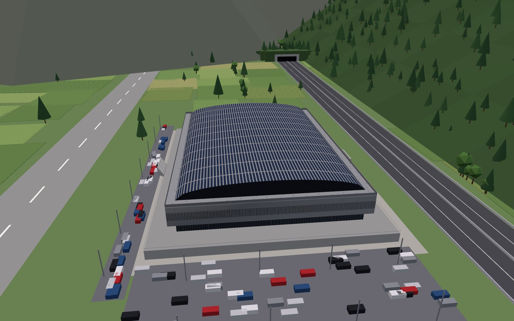
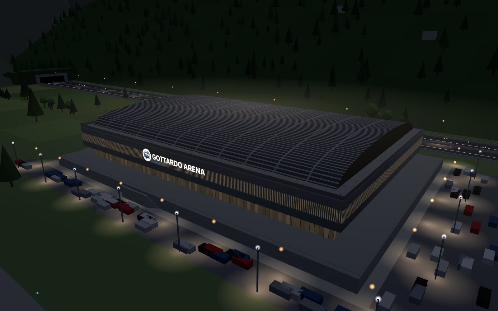
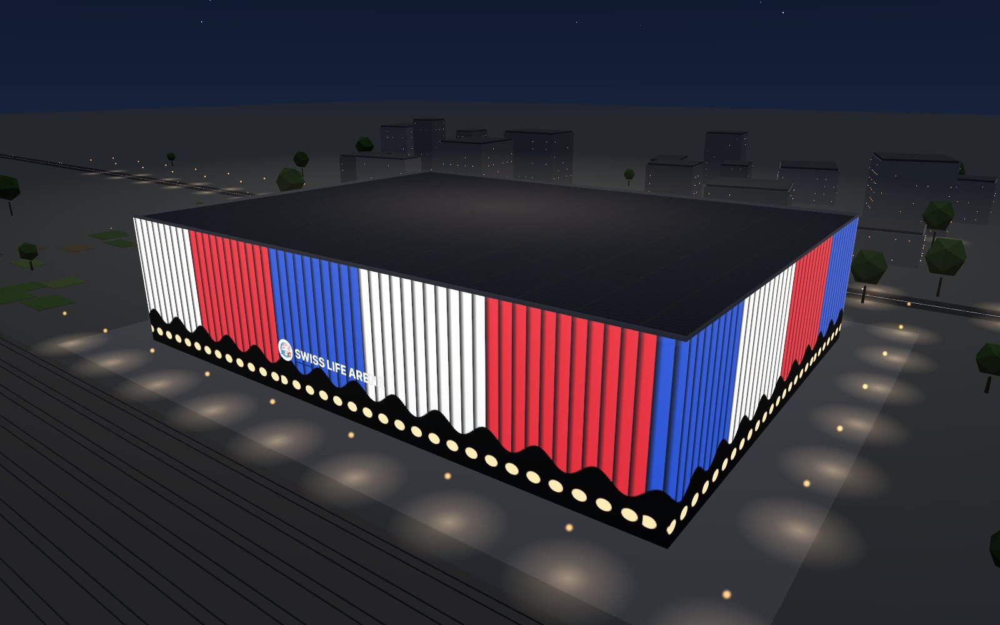
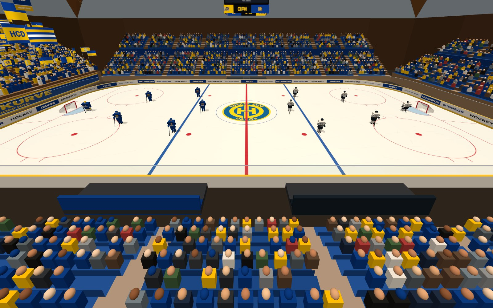

# 3DHockeyArena

**3DHockeyArena è il componente di LiveSportArena dedicato alle arene della National League di hockey su ghiaccio.** Ricostruisce in 3D le 14 piste del campionato. Ognuna ha le sue tribune, la curva di casa, il settore ospiti al posto giusto e l’edificio visto da fuori. Dentro ci sono le formazioni delle due squadre. Puoi arrivare in volo sopra Ambrì mentre cala la sera, entrare dal tetto e vedere chi scende in pista linea per linea.



*Ambrì · Gottardo Arena, l’intro di giorno.*

## Una sera ad Ambrì

L’intro parte di giorno, in alto sopra la valle. La **Gottardo Arena** sta tra l’aerodromo, i parcheggi e l’autostrada, sotto il versante boscoso. Sul basamento in cemento, con il cortile tutt’attorno, poggia un piano vetrato. Sopra c’è la scatola a feritoie, chiusa in cima da una volta a botte coperta di pannelli. Una scheda presenta l’arena e la squadra di casa.

Dopo una decina di secondi cala la notte. In facciata si accende la linea blu, il piazzale si riempie di lampioni e sull’autostrada scorrono i fari delle auto. In tutto l’intro dura **26 secondi**: alla fine, oppure subito con **Entra nell’arena**, la telecamera scende dal tetto sopra il ghiaccio illuminato.



*Ambrì · la stessa arena dopo il tramonto.*

Ogni arena ha la sua sera:

- a Friburgo la rete metallica della BCF Arena diventa blu, con una linea ambra;
- a Zurigo le pieghe della Swiss Life Arena si colorano di rosso, bianco e blu;
- a Davos i timpani vetrati del tetto a falde innevato brillano d’oro accanto alla pista all’aperto.



*Zurigo · Swiss Life Arena di sera.*

## Quattro modi di guardare una partita

- **Intro**: vista aerea dell’esterno, dal giorno alla notte, con la scheda di arena e squadra.
- **Formazioni**: telecamera fissa sulla pista. Casa a sinistra, ospiti a destra, una linea alla volta, con la tabella dei numeri e dei ruoli e il selettore dalla 1ª alla 4ª linea.
- **Tour**: la telecamera gira dentro l’arena mentre le linee si alternano da sole. Ogni pochi secondi compare una tabella: scheda dell’arena, ultimi incontri, head to head, squadre a confronto, migliori marcatori.
- **Esplora**: telecamera libera, con la vista in sezione dall’alto.



*Davos · VAT Arena, prima linea in pista.*

## Ogni arena com’è davvero

Tribune, tetti e facciate seguono le piantine ufficiali e le foto raccolte arena per arena. La curva di casa non è sempre dietro una porta: a Berna la Stehrampe occupa un intero lato lungo, e lo **Stehplatz Gast** sta in fondo alla stessa rampa. A Kloten e Rapperswil casa e ospiti dividono lo stesso lato corto. A Davos gli ospiti siedono nel settore **S12**, a Zugo stanno in piedi nei settori **127–128**.

Anche gli interni cambiano da un’arena all’altra:

- sedili blu a Davos e ad Ambrì, rossi a Losanna, grigi a Bienne;
- capriate in legno a triangoli a Porrentruy, volte incrociate in legno a Davos;
- capriate rosse e tabellone rotondo a Rapperswil;
- un grande anello luminoso appeso sotto il tetto di Friburgo.

La curva di casa ha i colori della squadra, bandiere che sventolano e lo striscione. Il settore ospiti prende i colori della squadra scelta come avversaria.

## Provarlo

I moduli JavaScript non partono aprendo `index.html` con doppio clic. Dalla cartella del progetto:

```bash
python3 -m http.server 8000
```

poi apri http://127.0.0.1:8000/. Serve un browser con WebGL attivo: se manca, la pagina lo segnala.

Si può aprire una partita già impostata: `?arena=HCAP&away=HCL&line=2&mode=tour`.

## Cosa è vero e cosa no

- **Vero**: posizione di curve, settori in piedi e settori ospiti; forma di tetti e facciate; colori di tribune e soffitti; capienza, anno di apertura e caratteristiche principali delle arene.
- **Stilizzato**: misure e dintorni. Servono a riconoscere ogni arena, non sono rilievi.
- **Da verificare**: il settore ospiti di Kloten e gli anni di fondazione dei club, tranne Lugano, Ginevra e Kloten.
- **Finto, per ora**: le formazioni (nomi e numeri segnaposto) e tutte le statistiche del tour, segnate «Dati di esempio».

## Documentazione

- [docs/ARENA-3D.md](docs/ARENA-3D.md): come è fatto il codice, come si descrive un’arena e come collegare dati veri.
- [docs/ARENE-RILIEVO.md](docs/ARENE-RILIEVO.md): il rilievo arena per arena, con le fonti e quanto ricavato dalle foto.
- [docs/STANDARD-ARENA.md](docs/STANDARD-ARENA.md): il livello di dettaglio e i controlli richiesti per ogni arena, con la Gottardo come riferimento.

Grafica con [Three.js](https://threejs.org/) 0.160.0, caricato da CDN.
