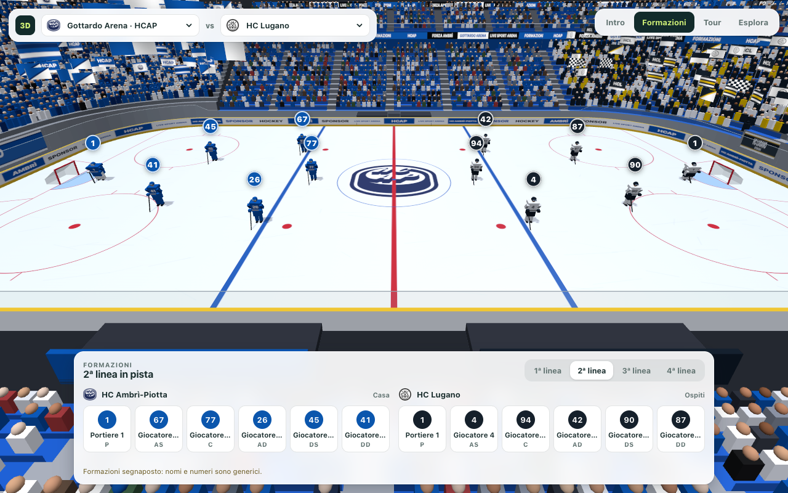
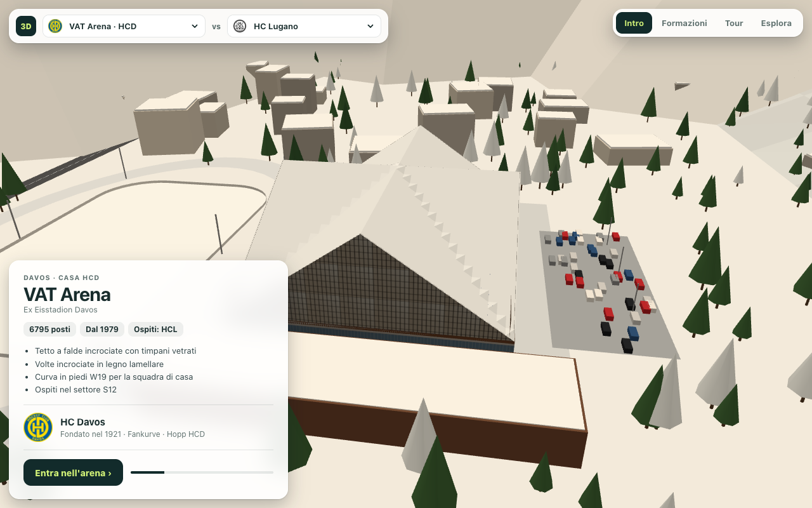

# 3DHockeyArena

**3DHockeyArena ti porta nelle 14 arene della National League svizzera.** Puoi arrivare alla Gottardo Arena prima di un derby, vedere chi scende sul ghiaccio per il secondo blocco o sorvolare il tetto della pista di Davos mentre si accendono le luci della sera.

*Ambrì, Ticino · Seconda linea di Ambrì-Piotta e Lugano alla Gottardo Arena.*

## Il derby dalla tribuna

Alla Gottardo Arena scegli il **Lugano** come ospite e apri **Formazioni**. Dalla tribuna vedi l’Ambrì-Piotta a sinistra e i bianconeri a destra. Passa dalla prima alla **2ª linea** per vedere come cambiano i due blocchi. La tabella sotto il ghiaccio abbina nomi, numeri di maglia e ruoli.

Con **Tour** la telecamera gira intorno alla pista mentre le linee si alternano sul ghiaccio. Tra un cambio e l’altro compaiono gli ultimi incontri, i confronti diretti e i migliori marcatori. Formazioni e statistiche sono dati dimostrativi.

## Sotto il tetto di Davos

A Davos scegli **Intro** per vedere la VAT Arena dall’esterno. Le falde del tetto si incontrano sopra il centro della pista. Accanto al palazzetto si distingue il ghiaccio all’aperto. Aspetta il tramonto per vedere i timpani vetrati illuminarsi, oppure scegli **Entra nell’arena** per passare subito all’interno.

*Davos, Grigioni · Vista aerea della VAT Arena.*

## Esplorare le arene

Scegli la pista dal menu e apri **Esplora**. Con **Dall’alto** puoi leggere la disposizione delle tribune intorno alle balaustre. Trascina per ruotare l’arena e usa la rotella o il gesto a pizzico per avvicinarti a un settore.

Per visitare le arene in locale, esegui `python3 -m http.server 8000` nella cartella del progetto e apri [la Gottardo Arena nel browser](http://127.0.0.1:8000/?arena=HCAP&away=HCL&line=2&mode=lineup). Servono WebGL attivo e una connessione per caricare Three.js.

I modelli ricostruiscono le caratteristiche di ogni pista, dai settori in piedi alla forma del tetto. I dettagli e i criteri di ricostruzione sono nelle [schede delle arene](docs/ARENE-RILIEVO.md).
